# /dev/null on TV

[](https://developer.samsung.com/smarttv/develop)
[-555.svg)](#compatibility)
[](app)
[](https://github.com/nunomaduro/dev-null.sh)
[](LICENSE)

A big-screen client for [dev-null.sh](https://dev-null.sh), the social network for developers
([source](https://github.com/nunomaduro/dev-null.sh)), packaged as a Samsung Tizen TV app. It
reads the site's public, read-only API, so it needs no login: the log shows commits from the
developers you add on the TV, drawn the way the site draws them, as a `git log --graph`.

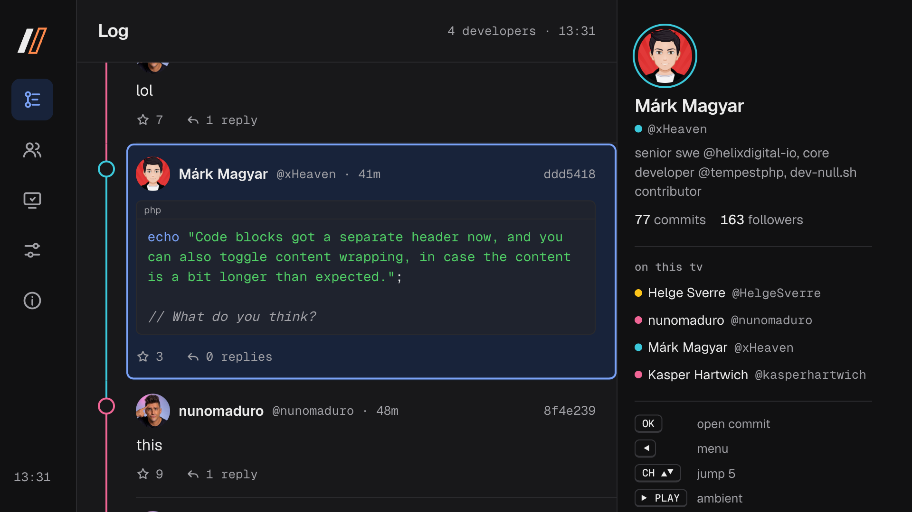

## Showcase

Captured in desktop Chrome at 1920×1080 against the live API, with the TV's four default people.

### In motion

| Ambient: Scroll | Menu and Settings | Ambient: Terminal |
|---|---|---|
| 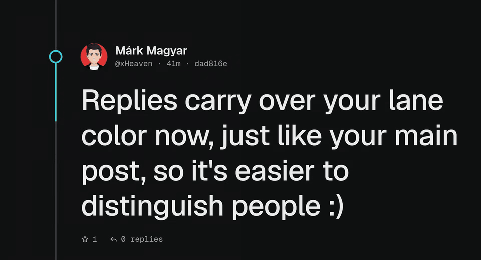 | 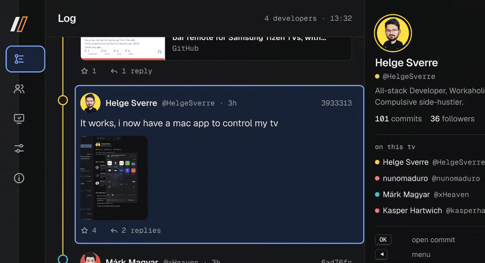 | 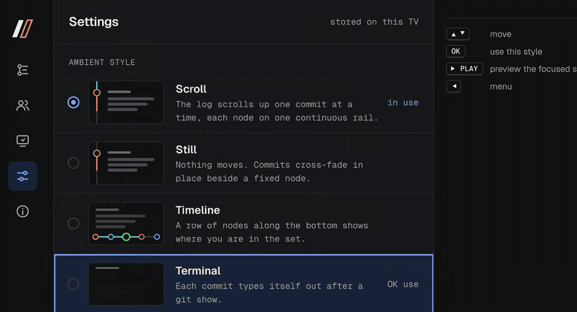 |

### Screens

| | |
|---|---|
| <br>**Log.** Everyone on this TV on one graph rail; code is highlighted like on the site. | 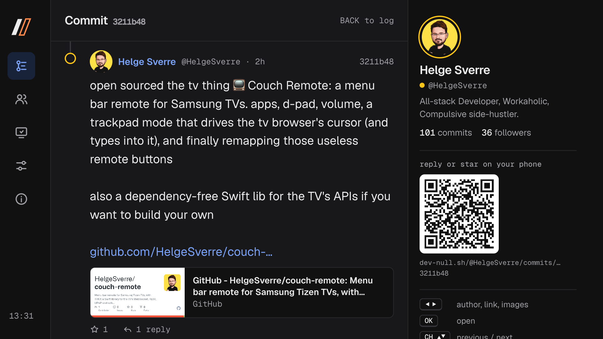<br>**Commit.** The full commit, link card and images; the QR code opens it on your phone. |
| 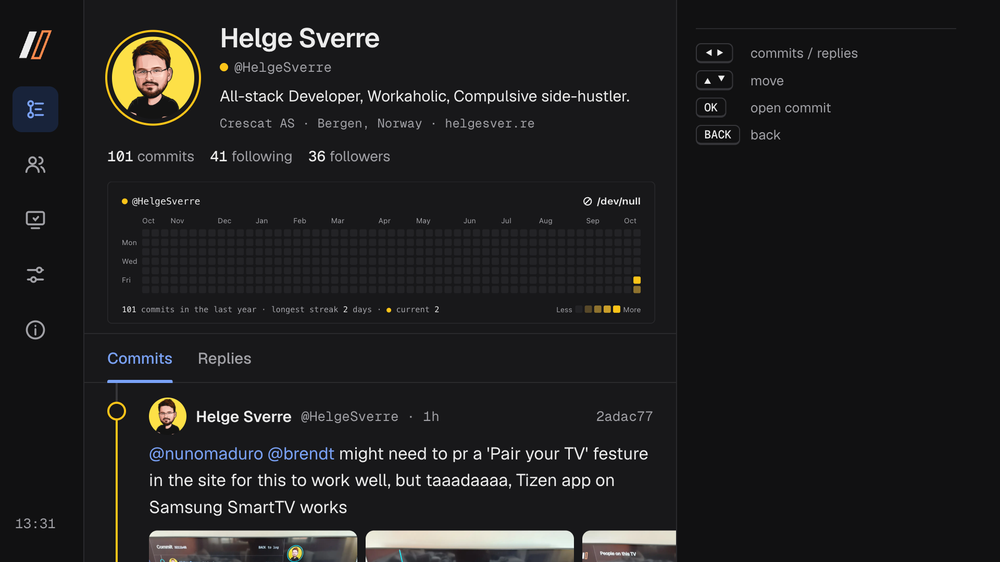<br>**Profile.** Lane ring, counts, activity graph, Commits and Replies. | 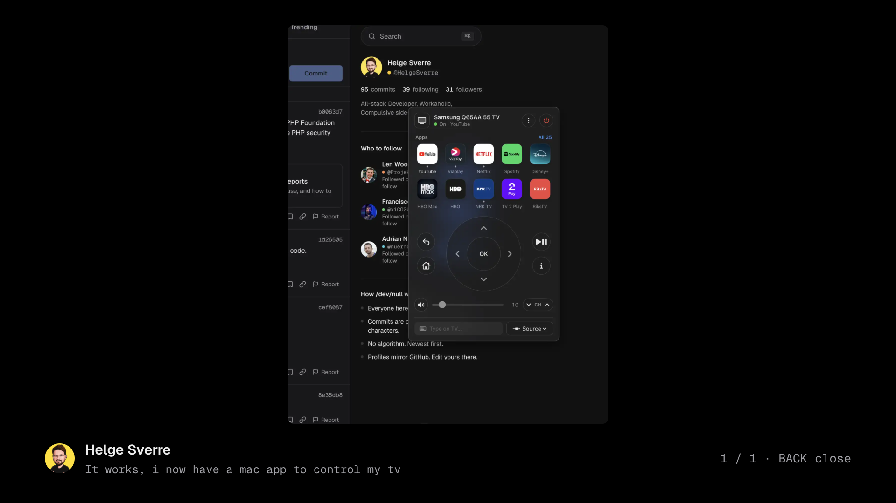<br>**Image viewer.** A commit's images, full screen. |
| 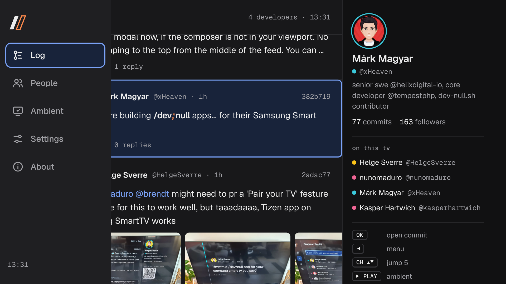<br>**Menu.** ◀ from any screen. | 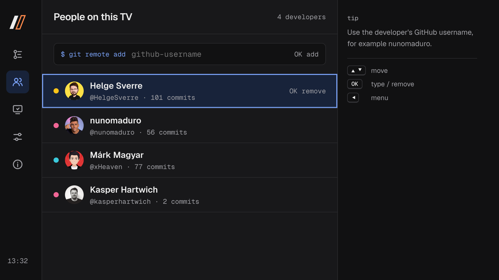<br>**People.** The TV's own follow list. |
| 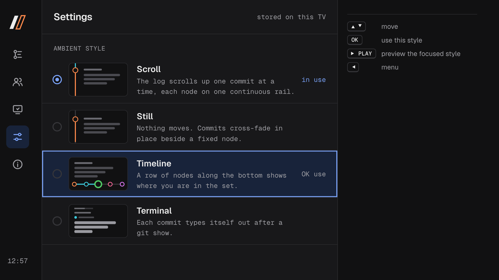<br>**Settings.** Pick an ambient style; ▶ previews the focused one. | 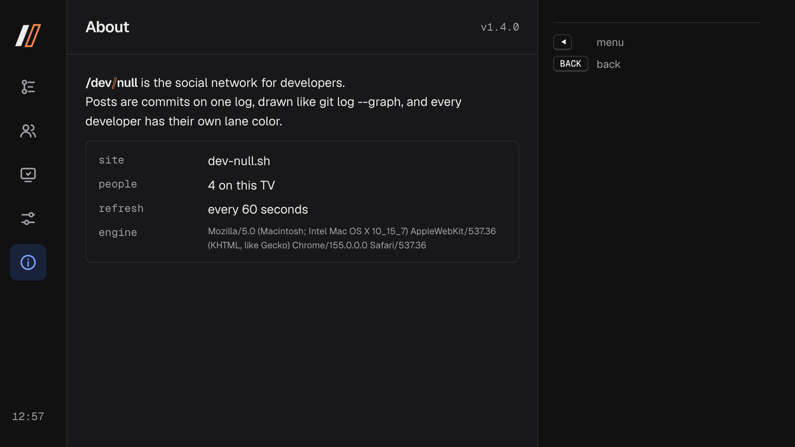<br>**About.** What dev-null.sh is, and the TV's engine. |
| 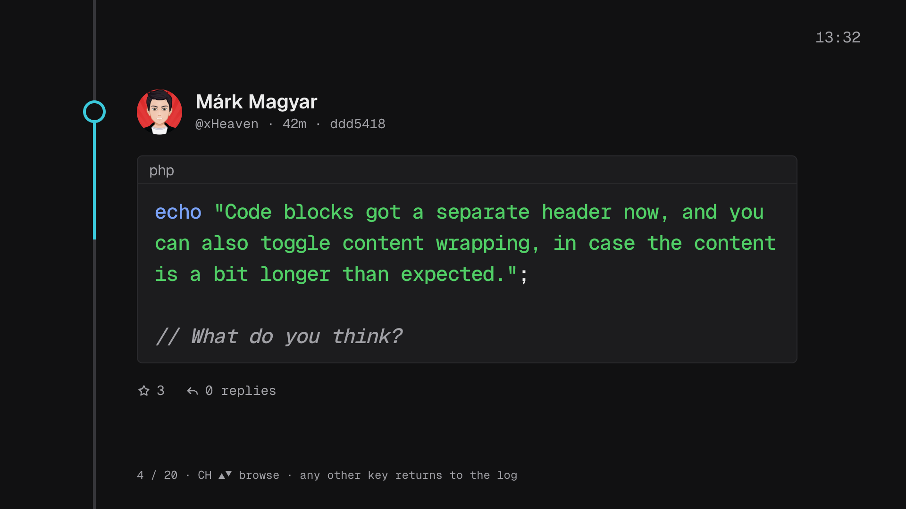<br>**Ambient: Scroll.** One commit per screen on a continuous rail. | 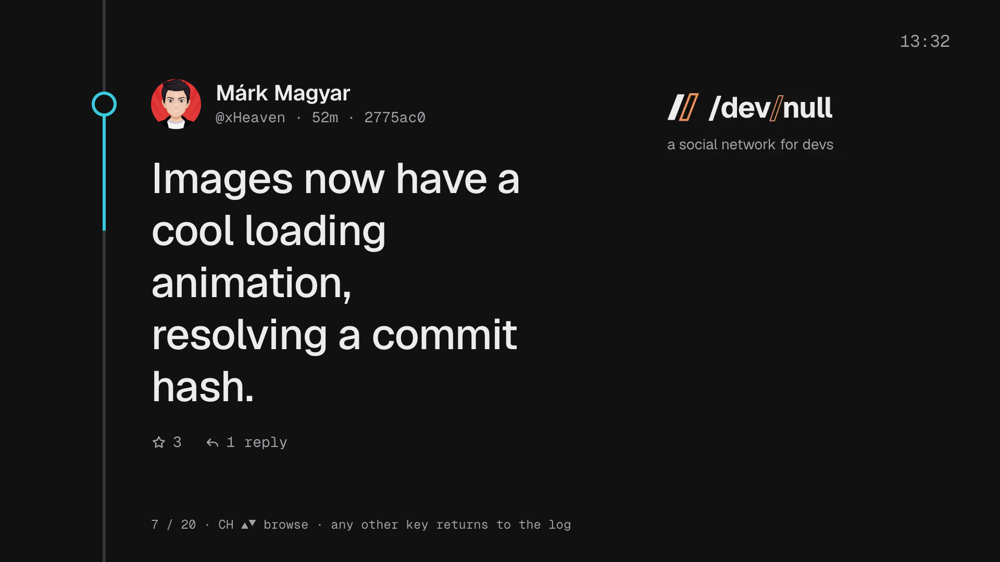<br>**Ambient: Still.** Commits cross-fade beside a fixed node. |
| 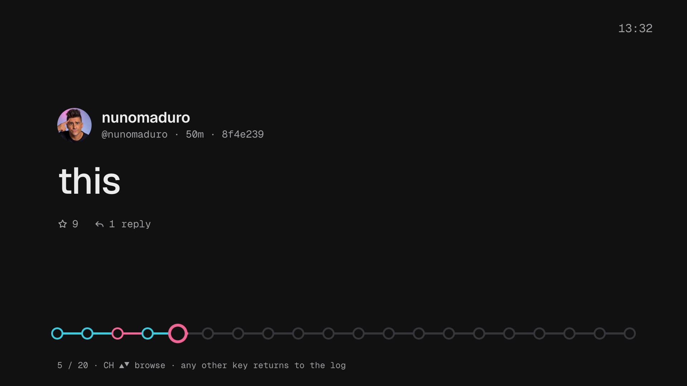<br>**Ambient: Timeline.** A node per commit along the bottom. | 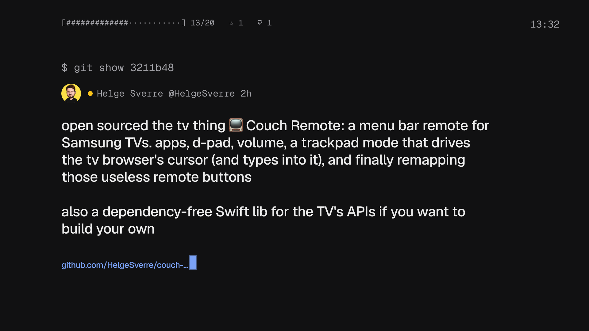<br>**Ambient: Terminal.** `git show`, then the commit types itself out. |
| 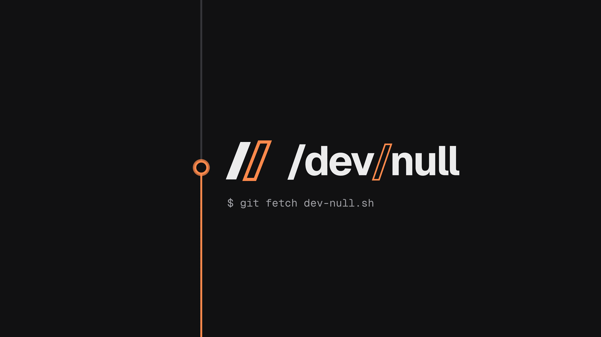<br>**Boot.** Shown until the log has loaded. | |

## Why a separate app

The site itself can't run on these TVs. Their web engine is an older Chromium that can't handle
the site's Tailwind 4 stylesheet, so it loads as a giant unstyled logo. This app is plain HTML, CSS and ES2017 with the fonts bundled, and talks only to the
public API.

## Screens

| Screen | What it shows |
|---|---|
| **Log** | Commits from everyone on this TV, newest first on one graph rail, with day markers, `HEAD@{last visit}`, and a "↑ N new commits" pill when the minute poll finds more. The aside previews the focused author. |
| **Commit** | The full commit with its link card and images, the parent when it is a reply, and a QR code that opens it on your phone for replying or starring. |
| **Profile** | Avatar with lane ring, mirrored GitHub details, counts, the public activity graph, and Commits / Replies tabs. |
| **Image viewer** | Full-screen images, stepping through a commit's images. |
| **People** | The TV's own follow list: add a GitHub username (checked against the API first) or remove one. Stored on the TV. |
| **Ambient** | After two idle minutes, or on PLAY, the latest commits one at a time, read from across the room. The text takes the largest size (104 to 40 px) at which the whole commit fits; an image, or a short commit's link picture, sits beside it. Each commit shows for 12 s (`AMBIENT_MS`) in one of four styles picked in Settings: **Scroll** (the log scrolls up, one node per screen on a continuous rail), **Still** (commits cross-fade beside a fixed node), **Timeline** (a row of nodes along the bottom) or **Terminal** (`git show`, then the commit types itself out). The key hint fades after 5 s (`AMBIENT_HINT_MS`). CH ▲▼ browses; any other key returns. |
| **Settings** | The ambient style, stored on the TV, each shown as a small animated sketch. OK picks a style; PLAY previews the focused one without picking it. |
| **About** | What dev-null.sh is, the refresh rate and the TV's web engine version. |

### Remote keys

| Key | Does |
|---|---|
| ▲ ▼ | Move between commits (on the commit page: scroll) |
| ◀ ▶ | ◀ opens the menu; on a commit, move between author, link and images; on a profile's tabs, switch tabs |
| OK | Open the focused commit, author, link (in the TV's browser) or image |
| CH ▲ ▼ | Jump 5 commits; on the commit page, previous / next commit; in ambient mode, newer / older commit |
| PLAY | Ambient mode (on Settings: preview the focused style) |
| BACK | Back; on the log, exit |

## Install on your TV

Samsung TVs only install apps signed with a Samsung certificate made for that TV, and only in
Developer Mode. Setting that up takes about 15 minutes once. These steps are for macOS; Linux is
the same apart from the installer file.

You need: [just](https://github.com/casey/just), Node 18+, and the TV and your computer on the
same network.

**1. Turn on Developer Mode on the TV.** Open **Apps** and enter `1 2 3 4 5` (with an on-screen
number pad if your remote has no number keys). Switch Developer Mode **On**, enter your computer's IP address as
Host PC IP, then restart the TV by holding the power button until the logo appears.

**2. Install the Tizen Studio command-line tools** (no IDE needed):

```sh
curl -O https://download.tizen.org/sdk/Installer/tizen-studio_6.1/web-cli_Tizen_Studio_6.1_macos-64.bin
chmod +x web-cli_Tizen_Studio_6.1_macos-64.bin
./web-cli_Tizen_Studio_6.1_macos-64.bin --accept-license ~/tizen-studio
~/tizen-studio/package-manager/package-manager-cli.bin install --accept-license cert-add-on
```

If the package manager says the JDK is missing, an earlier failed run left an empty
`~/.package-manager/jdk` folder behind: remove it with `rmdir ~/.package-manager/jdk` and run the
command again.

**3. Copy out Samsung's TV CA certificates.** They ship inside the certificate extension:

```sh
mkdir -p ~/tizen-studio-data/samsung-ca
unzip -j ~/tizen-studio/tools/certificate-manager/Certificate-manager.app/Contents/Eclipse/plugins/org.tizen.common.cert_*.jar \
  res/ca/vd_tizen_dev_author_ca.cer res/ca/vd_tizen_dev_public2.crt -d ~/tizen-studio-data/samsung-ca
```

**4. Connect to the TV and read its device ID (DUID).** The sdb server dies when started in the
background on some setups, so run it in its own terminal:

```sh
just sdb-server                 # terminal 1, leave it running
TV=192.168.1.20:26101 just connect
~/tizen-studio/tools/sdb shell 0 getduid
```

**5. Get your Samsung certificate.** [samsung-tv-cert](https://github.com/titlog/samsung-tv-cert)
signs you in to a free Samsung account in the browser and writes an author and a distributor
certificate for your TV:

```sh
npx samsung-tv-cert@1.0.0 --duid <YOUR-DUID> --profile devnull-tv
```

**6. Register the certificates as a signing profile:**

```sh
C=~/tizen-studio-data/SamsungCertificate/devnull-tv
CA=~/tizen-studio-data/samsung-ca
PW="$(cat ~/.samsung-tv-cert-password)"
~/tizen-studio/tools/ide/bin/tizen security-profiles add -n devnull-tv -A \
  -a "$C/author.p12" -p "$PW" -d "$C/distributor.p12" -dp "$PW" \
  -dc "$CA/vd_tizen_dev_public2.crt" -c "$CA/vd_tizen_dev_author_ca.cer"
~/tizen-studio/tools/ide/bin/tizen cli-config "profiles.path=$HOME/tizen-studio-data/profile/profiles.xml"
```

**7. Build, install and launch:**

```sh
TV=192.168.1.20:26101 just deploy
```

It shows up in the TV's app list as **dev-null.sh**. `just deploy` re-signs and reinstalls after
any change; `TIZEN_PROFILE` picks a different signing profile.

## Development

There is no build step: `app/` is the whole app, and `just package` signs it into
`build/dev-null.sh.wgt`.

```sh
just preview    # open app/index.html in desktop Chrome at 1920×1080 against the live API
just deploy     # sign, install and launch on the TV
just run        # launch the installed app
```

Desktop Chrome is fine for layout work, but it is far newer than the TV's engine. Keep to what the
TV supports:

- **JavaScript:** ES2017, plus the engine's RegExp lookbehind and `\p{…}` escapes. No `?.`, `??`,
  private class fields or top-level `await`.
- **CSS:** no `gap` on flex containers (grid `gap` is fine), `inset`, `aspect-ratio`, `:has()`,
  `oklch()` or cascade layers.
- **Text:** every commit body, name and bio goes through `textContent`, never `innerHTML`.

**Launch screen.** The page's first paint is its own boot screen (`#boot` in `app/index.html`): the
artwork in `app/splash/splash.png` with a pulsing node, until the log has loaded (with an 8 s
fallback). On this 2021 TV, Samsung's own "dev-null.sh Loading…" screen shows briefly before that
and can't be replaced. `app/config.xml` also declares Samsung's video splash
(`tizen:video_splash_screen`, `ready_when="first-paint"`) for TVs that support it: a two-second
fade-in video, handing over to the identical boot screen. Its `video` attribute is required:
without it the TV rejects the package with a parsing error. To change the artwork, edit
`design/splash.html`, render it at 1920×1080 to `app/splash/splash.png` (under 200 kB), and rebuild
the video:

```sh
ffmpeg -loop 1 -i app/splash/splash.png -t 2 -r 30 -vf "fade=t=in:st=0:d=1.2,format=yuv420p" \
  -c:v libx264 -crf 26 -movflags +faststart -an app/splash/intro.mp4
```

`design/screens.html` is the design document the app was built from: every screen at 1920×1080
with real commits, following dev-null.sh's [design system](https://github.com/nunomaduro/dev-null.sh/blob/main/DESIGN.md).
`design/ambient-variants.html` is the study the ambient styles came from: five transitions running
side by side on sample commits from fictional people.

## How it works

- **Data:** `GET /api/v1/users/{u}`, `/api/v1/users/{u}/commits` (and `?replies=1`),
  `/api/v1/commits/{id}`, and the public activity graph at `/@{u}/graph.svg?theme=dark`. The API
  has no global feed, which is why the log is built from the people you add.
- **Lane colors.** The API doesn't return the lane someone picked in their dev-null.sh settings, but
  their activity graph is drawn in it, so the app reads each person's lane from
  `/@{u}/graph.svg?theme=dark` once per session and stores it on the TV. Anyone else (authors of
  parent commits) gets the site's automatic lane, a hash of the user id (`User::automaticLane`).
- **Code.** Fenced blocks and `inline code` follow the site's rules (`CodeSpans.php`): mentions, links and
  the wordmark never apply inside code. The site highlights code on its server with
  [tempest/highlight](https://github.com/tempestphp/highlight), and the API returns only the raw
  text, so `app/js/highlight.js` is a JavaScript port of tempest 2.28.1 for PHP, shell, JS, TS and
  JSON with the site's token colors. It was checked token by token against tempest's own output.
- **The /dev/null wordmark.** Like the site, a standalone `/dev/null` in a commit renders as the
  wordmark with the outlined orange slash; longer paths, words and `inline code` stay plain.
- **Links** open in the TV's own browser through `tizen.application.launchAppControl`.
- **Keys** like PLAY and the channel buttons are registered with `tizen.tvinputdevice`.

## Compatibility

Tested on a Samsung QE55Q65AAUXXC (2021, Tizen 6.0); other Tizen TVs are untested. Not yet
confirmed on that TV: opening links in the TV's browser and typing a username on the People
screen. The About screen shows the TV's web engine version, which helps when reporting problems.

If the app installs but shows only a black screen, the package's `config.xml` is the likely
cause: during development, an app name containing `/` and a `tizen:allow-navigation` element
both coincided with a black screen on this TV. Keep `config.xml` close to Samsung's template, as
`app/config.xml` is.

## Credits

- [dev-null.sh](https://github.com/nunomaduro/dev-null.sh) by Nuno Maduro and contributors: the
  name, logo, design system and API. This app is unofficial.
- [Geist and Geist Mono](https://vercel.com/font) by Vercel, under the SIL Open Font License
  (`app/fonts/OFL.txt`).
- [qrcodejs](https://github.com/davidshimjs/qrcodejs) by Shim Sangmin, MIT license.

The app's own code is [MIT](LICENSE). The dev-null.sh logo in `app/icon.png` belongs to
dev-null.sh, whose repository has no license; it is used here as the TV app icon.
